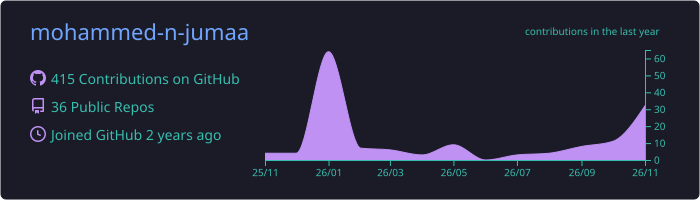
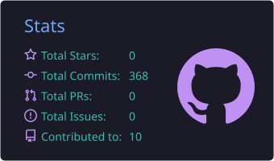
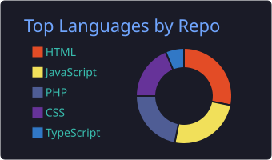
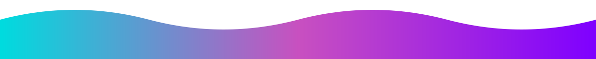

<!-- ===================== HEADER ===================== -->

  

  
  

---

## 👨‍💻 About Me

- 🚀 **Full Stack Developer** passionate about building fast, beautiful and scalable web apps
- 💡 I love turning complex problems into simple, elegant interfaces
- 🛠️ Currently working with **React, Next.js, TypeScript & Laravel**
- 🌱 Always learning new technologies and best practices
- 🤝 Open to collaboration on exciting projects
- ⚡ Fun fact: I write code in English and dream in Arabic 😄

 

---

## 🛠️ Tech Stack

  
    
  
    
  

---

## 🌟 Featured Projects

<table align="center">
  <tr>
    <td width="50%" valign="top">
      <h3>🎮 <a href="https://github.com/mohammed-n-jumaa/Gaming_portfolio">Gaming Portfolio</a></h3>
      
A gaming-themed interactive portfolio with bold visuals and smooth animations.

      
      
        
      
    </td>
    <td width="50%" valign="top">
      <h3>🥗 <a href="https://github.com/mohammed-n-jumaa/RanLogic">RanLogic</a></h3>
      
A personalized nutrition platform that builds custom diet plans for every user.

      
      
        
      
    </td>
  </tr>
  <tr>
    <td width="50%" valign="top">
      <h3>📝 <a href="https://github.com/mohammed-n-jumaa/Jocom_Feedback">Jocom Feedback</a></h3>
      
A feedback management system to collect, organize and analyze user feedback.

      
      
        
      
    </td>
    <td width="50%" valign="top">
      <h3>🍊 <a href="https://github.com/mohammed-n-jumaa/Orang_Community_React">Orange Community</a></h3>
      
A community platform with a React frontend and a PHP backend.

      
      
        
      
    </td>
  </tr>
  <tr>
    <td colspan="2" align="center" valign="top">
      <h3>🏆 <a href="https://github.com/mohammed-n-jumaa/Master_piece_work">Master Piece</a></h3>
      
My masterpiece graduation project — a complete full stack web application.

      
      
      
        
      
    </td>
  </tr>
</table>

---

## 📊 GitHub Stats

  

  
  

  

---

## 🐍 Contribution Snake

  <picture>
    <source media="(prefers-color-scheme: dark)" srcset="https://raw.githubusercontent.com/mohammed-n-jumaa/mohammed-n-jumaa/output/github-contribution-grid-snake-dark.svg" />
    
  </picture>

---

## 📫 Let's Connect

  
  
  
  

  

